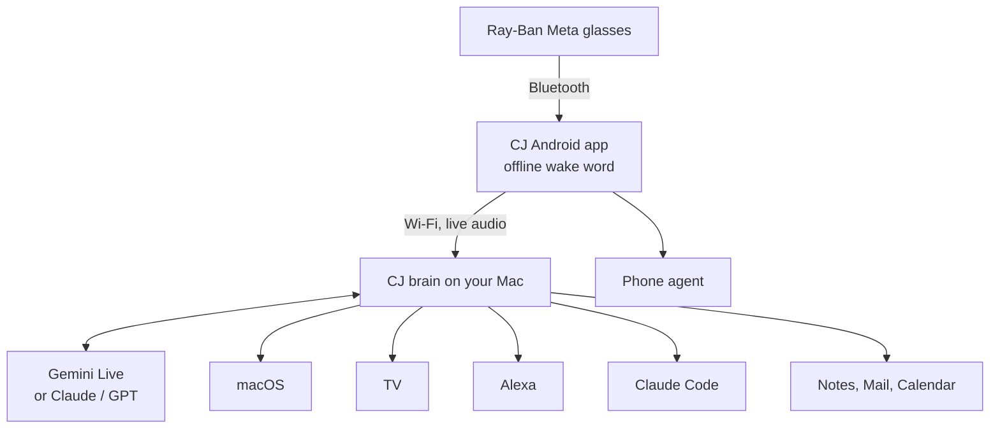

# Ray-Ban Meta GOD MODE

## iOS companion (this fork)

This fork adds a native SwiftUI app in [`ios-app/`](ios-app/README.md). Open
[`ios-app/CJ.xcodeproj`](ios-app/CJ.xcodeproj) in Xcode to build for iPhone or Simulator.
It reuses the Python brain and supports QR/manual pairing, text and photo
questions, live voice over Bluetooth, and Meta glasses camera frames through DAT 1.0.1.

See the [iOS setup, supported features, and verification guide](ios-app/README.md).
Use [CJ Bridge for Mac](mac-app/README.md) to choose Codex with your ChatGPT login
or Claude Code with your Claude login. Subscription mode uses on-device iPhone
speech and runs the Mac assistant with unrestricted tool access. Gemini API is
still available as an explicit option for streaming voice.
The iOS port includes opt-in, on-device “CJ” wake listening while its microphone session is active. It does not include Android accessibility automation or wake after the app is force-quit.
The upstream Android app remains available below.

---

**CJ** is an open-source assistant for Ray-Ban Meta glasses. Say "CJ" and talk. It books your ride, runs your Mac,
puts Netflix on the TV, switches off the lights and ships your code while your phone stays in your pocket.

[](LICENSE)
[](https://github.com/GhanshyamPaunikar/rayban-meta-god-mode/releases/latest)


**[Download the Android app](https://github.com/GhanshyamPaunikar/rayban-meta-god-mode/releases/latest/download/CJ.apk)**
· [Get started](#get-started) · [What you can say](#what-you-can-say) · [How it works](#how-it-works)

<p>
  
  &nbsp;
  
  &nbsp;
  
</p>

```text
You  CJ, book me an Uber to the airport.
CJ   Uber Go is ₹240, arriving in 4 minutes. Should I request it?
You  Yes.
CJ   Requested. Your ride is on its way.
You  And put lo-fi on the living room TV. Oh, and turn off the bedroom lights.
CJ   Playing on the TV. Bedroom lights are off.
You  Bye.
```

One wake word starts the conversation. You can interrupt mid-answer, change the subject, or switch languages, and it
ends when you say goodbye.

## Why this exists

Ray-Ban Meta glasses already come with Meta AI. It answers questions, takes photos and tells you what you're looking
at, but it can't do anything on the devices you own. It can't request the cab, type on your laptop or switch off the
lights, so for most real tasks you still end up taking out your phone.

Meta has since opened the glasses' camera, microphones and speakers to developers through the Wearables Device Access
Toolkit, and CJ is built on it. The glasses are the microphone and speaker, the phone is the bridge, and your Mac
does the work using the apps and accounts it is already signed in to. There is no CJ server and no CJ account. The only
outside services are the AI model you choose and the integrations you turn on, and every key stays on your Mac.

Meta AI keeps working alongside it: "Hey Meta" still goes to Meta, and "CJ" goes to CJ.

## Features

- **Phone agent.** Books Uber, reorders on Swiggy, sends WhatsApp messages. It reads the price back and waits for a
  spoken yes before anything is paid, booked or sent.
- **Mac control.** Opens and switches apps, presses keys, types, finds files, plays music, reads your screen, manages
  Calendar, Reminders and Mail.
- **Coding on the go.** Sends tasks to [Claude Code](https://claude.com/claude-code) in your projects and tells you
  when they're done.
- **Smart home.** Lights, AC, fans, plugs and routines through Alexa.
- **TV remote.** Fire TV and Android TV: open apps, search YouTube, play, pause, volume.
- **Meeting notes.** Transcribes as you talk, then gives you a summary with decisions and action items.
- **Live translation.** The other person's words in your ear, yours out loud from the phone, in 20+ languages.
- **Look and do.** Turns a poster into a calendar event, a business card into a contact, a Wi-Fi card into a
  connection.
- **Nudges and visual memory.** Reminds you of your shopping list near a shop, and (if you opt in) remembers what
  you've seen as short text notes.

It's fast because it streams: answers start about a second after you stop talking, using Gemini Live. The wake word
runs offline on the phone, so nothing is sent until you say "CJ". It runs on the free tiers of Gemini and Azure
Speech, and you can switch the brain to Claude or GPT with one command.

## Get started

You need Ray-Ban Meta glasses (Gen 1 or Gen 2), an Android 10+ phone with the Meta AI app, a Mac on the same Wi-Fi,
and a free [Gemini API key](https://aistudio.google.com/apikey). Setup takes about ten minutes.

For everyday personal use it runs on free tiers. When one Gemini model hits its free limit, CJ moves on to the next one
in `CJ_GEMINI_MODELS`. Azure Speech, Claude and GPT are optional, and you only pay for them if you add a key.

**1. Turn on Developer Mode.** In the Meta AI app, open Settings → App info, tap the version number five times, and
turn on Developer Mode.

**2. Start the brain on your Mac.**

```bash
git clone https://github.com/GhanshyamPaunikar/rayban-meta-god-mode.git
cd rayban-meta-god-mode/brain
./set-key.sh gemini      # stored in ~/.cj, never in the repo
./run.sh                 # prints a QR code for pairing
```

**3. Install the app and pair.** [Download CJ.apk](https://github.com/GhanshyamPaunikar/rayban-meta-god-mode/releases/latest/download/CJ.apk)
on your phone and install it. In CJ, go to Setup → Scan QR code, then Link glasses. Say "CJ".

<details>
<summary>Permissions</summary>

<br/>

On the Mac, allow Accessibility, Screen Recording, Calendar, Reminders, Contacts, Mail and Notes for the app that runs
the brain. On the phone, allow Location (travel times and nudges) and Phone (calling a number you looked at), and turn
on **CJ phone agent** under Settings → Accessibility if you want CJ to use apps for you.

</details>

<details>
<summary>Optional: natural voice, TV, smart home, other models</summary>

<br/>

```bash
./set-key.sh azure_speech      # natural Azure voice
./set-tv.sh 192.168.1.50       # your TV's IP, with ADB debugging on
./set-key.sh claude            # Claude (Sonnet 5.5 by default) as the brain
./set-key.sh openai            # or a GPT model
./set-key.sh alexa             # smart home
```

**Smart home.** Download [alexa-cookie-cli](https://github.com/adn77/alexa-cookie-cli/releases) and run it for your
Amazon site, for example `./alexa-cookie-cli-macos -p amazon.in -a en_IN -L en-IN` (UK: `-p amazon.co.uk -a en_GB -L en-GB`,
US: `-p amazon.com -a en_US -L en-US`). Sign in at http://127.0.0.1:8080 and paste the refresh token it prints
(it starts with `Atnr|`) into `./set-key.sh alexa`. CJ never sees your Amazon password, and you can revoke the token
under Amazon → Manage Your Devices. This uses the Alexa app's unofficial web API, so it may break if Amazon changes it.

**Claude Code.** Install [Claude Code](https://claude.com/claude-code) and sign in once by running `claude`. CJ works
in git repositories under `~/Documents`, `~/Developer`, `~/Projects`, `~/code` or `~/src`.

</details>

<details>
<summary>Building the app yourself</summary>

<br/>

```bash
./scripts/get-wake-model.sh    # offline wake-word model, ~37 MB
cd android-app && ./gradlew installDebug
```

Requires JDK 17 and the Android SDK. Your own build and the released APK are signed with different keys, so uninstall
one before installing the other.

</details>

## What you can say

<details>
<summary>Conversation</summary>

<br/>

Say "CJ", wait for the beep, and talk. Follow-ups like "and tomorrow?" just work, and you can cut in with "no wait,
Mumbai". End with "bye", "I've got to go", "talk to you later", "chalo, bye" or the equivalent in your language.
To use the classic Azure voice instead of real-time, turn off **Real-time voice** in Setup.

</details>

<details>
<summary>Phone</summary>

<br/>

| Say | What happens |
|---|---|
| "Book me an Uber to the airport" | Opens Uber with the drop-off filled in and asks "Request Uber Go, ₹240. Should I?" |
| "Order my usual chai on Swiggy" | Finds your past order and asks before paying |
| "Send mom a WhatsApp saying I'm on my way" | Types the message and sends it when you say yes |

The confirmation is enforced in code, not in the prompt, so text on a screen can't talk CJ out of it. CJ never types
passwords, OTPs, PINs or card details; it hands those steps back to you.

</details>

<details>
<summary>Look and do</summary>

<br/>

| Look at | Say | What happens |
|---|---|---|
| A poster or invite | "Add this to my calendar" | Creates the event with date, time and place |
| A business card | "Save this contact", "call this number" | Saves it, or calls after you confirm |
| A café's Wi-Fi card | "Connect my laptop to this Wi-Fi" | Your Mac joins the network |
| A whiteboard | "Turn this into notes", "email it to Rahul" | A clean write-up in Notes or an email |
| Anything | "What is this?", "ye kya hai?" | Answers from a photo |

</details>

<details>
<summary>Mac</summary>

<br/>

| Say | What happens |
|---|---|
| "Open VS Code", "switch to Chrome", "close Spotify" | Opens, switches or quits apps (quitting asks first) |
| "New tab", "go back", "scroll down", "save" | Presses the keys |
| "Type: running ten minutes late" | Types into the frontmost app |
| "Open my resume" | Finds and opens the document |
| "What's on my screen?" | Describes a screenshot |
| "Play lo-fi on YouTube", "next song", "volume 30" | Music and volume |
| "What's on my calendar today?", "remind me to call mom" | Calendar and Reminders |
| "Run my Focus shortcut" | Runs any macOS Shortcut |
| "Lock my Mac", "dark mode on", "how much storage is left?" | System controls |

</details>

<details>
<summary>Code</summary>

<br/>

| Say | What happens |
|---|---|
| "Help me with this error" | Reads the error on your screen and explains the fix |
| "Ask Claude Code to add a dark mode toggle to my portfolio project" | Confirms, then starts Claude Code in that project |
| "How's Claude Code doing?" | Reports progress |
| "Tell Claude Code to also add a test" | Continues the same session |

CJ tells you when the job finishes. Claude Code can read and edit files and run read-only git commands, but no other
shell commands.

</details>

<details>
<summary>TV and smart home</summary>

<br/>

| Say | What happens |
|---|---|
| "Open Netflix on the TV" | Launches it (also YouTube, Prime Video, Hotstar, Spotify, Stremio) |
| "Play lo-fi beats on YouTube on the TV" | Searches YouTube on the TV |
| "Pause the TV", "turn it up", "go home" | Remote control |
| "Turn off the bedroom lights", "dim the living room to 30%" | Lights |
| "Set the AC to 24", "AC band karo", "turn on the fan" | AC, fans, plugs |
| "Start movie time", "good night" | Alexa routines |

Devices from Google Home, Smart Life or Philips Hue work too if they're linked to Alexa.

</details>

<details>
<summary>Notes, translation and memory</summary>

<br/>

| Say | What happens |
|---|---|
| "Take a note: call the plumber on Monday" | Saves it |
| "Start taking notes" … "stop taking notes" | Transcribes, then reads back a summary; the full text goes to Apple Notes |
| "Summarise my notes from this week" | Summary and search over everything you've noted |
| "Translate for me, she speaks Spanish" | Two-way live translation until you say "stop translating" |
| "Remember I parked at B2, pillar 14" | Remembers it for later |
| "What was that café I walked past this morning?" | Searches visual memory (opt-in) |

With visual memory on, the glasses take a photo every five minutes; CJ keeps a one-line description and discards the
photo. Say "pause visual memory" to stop it.

</details>

<details>
<summary>Everyday</summary>

<br/>

| Say | What happens |
|---|---|
| "Good morning" | Date, weather and headlines |
| "How long to the airport?" | Travel time from where you are, with a Maps link |
| "Email Rahul saying I'm running late" | Reads the email back and sends it after you say yes |
| "Remind me in 10 minutes to check the chai" | Timer in your ear |
| "Kal Mumbai mein mausam kaisa rahega?", "dollar rate?" | Live weather, rates and facts |

CJ understands and replies in English, Mandarin, Hindi, Spanish, French, Arabic, Bengali, Portuguese, Russian, Urdu,
Japanese, German, Korean, Italian, Turkish, Indonesian, Tamil, Telugu, Marathi, Gujarati and Hinglish.

</details>

## How it works



The Android app connects to the glasses through Meta's Wearables Device Access Toolkit and listens for the wake word
on-device with Vosk. When you speak, it streams audio to a small Python server on your Mac, which holds a Gemini Live
session, runs tools (Mac actions, TV over ADB, Alexa, web lookups) and streams the voice back. The phone agent runs
on the phone itself through an accessibility service.

Here is what happens when you say "CJ, turn off the bedroom lights":

1. The glasses send microphone audio to the phone over Bluetooth. Vosk listens for "CJ" on the phone, and nothing
   leaves the phone before that.
2. The app beeps and opens a WebSocket to the brain. It finds the brain on your Wi-Fi with mDNS and authenticates
   with the token from the QR code.
3. The brain streams your voice to Gemini Live. The model decides this is a job for the `device_action` tool and
   asks for the bedroom lights to be turned off.
4. The brain checks that the action is on its allowed list, passes it to Alexa as if you had said it to your Echo,
   and hands the result back to the model.
5. Gemini answers "Bedroom lights are off", and the audio streams back to the glasses while it's still being
   generated.

When an action has a cost or can't be undone, such as a booking, an order, a message or an email, the brain stops
after step 3. It reads back exactly what it is about to do and waits for you to say yes.

| Folder | What's in it |
|---|---|
| `brain/app/main.py` | FastAPI server, pairing and the `/ws/live` audio socket |
| `brain/app/live.py` | Gemini Live session: streaming audio in and out, interruptions, the tools the model can call |
| `brain/app/mac.py` | Every action CJ can take on your devices, and which ones need a spoken yes |
| `brain/app/tv.py`, `alexa.py` | TV and smart home |
| `brain/app/tools.py` | Live lookups: weather, news, facts, exchange rates |
| `brain/app/models/` | Gemini, Claude, GPT and a mock model for offline tests |
| `android-app/.../Glasses.kt` | Connection to the glasses through Meta's toolkit |
| `android-app/.../WakeWord.kt` | Offline "CJ" detection with Vosk |
| `android-app/.../Agent.kt` | The phone agent, which uses Uber, Swiggy and WhatsApp for you |

## Privacy and safety

- The wake word runs offline; audio stays on the phone until you say "CJ".
- API keys, the Alexa token and the pairing token live in `~/.cj` on your Mac with mode 600. The repo contains none.
- CJ can only perform a fixed list of actions. Sending email, quitting apps and starting Claude Code ask first.
- Text on screens and in photos is treated as content, never as instructions.
- Location is used only for travel times and nudges and isn't stored, except for places you name.
- Visual memory is off by default and stores text only.
- Memory and notes are plain files you own: `~/.cj/memory.json` and `~/.cj/notes.json`.

## Configuration

| Variable | Default | Description |
|---|---|---|
| `CJ_PROVIDER` | `gemini` | `gemini`, `claude` or `openai` (set by `set-key.sh`) |
| `CJ_CLAUDE_MODEL` | `claude-sonnet-5-5` | Claude model when Claude is the brain |
| `CJ_OPENAI_MODEL` | | GPT model when OpenAI is the brain |
| `CJ_VOICE` | `en-US-Olivia:MAI-Voice-2.1-Flash` | Azure voice; compare with `tools/azure_voice_samples.py` |
| `CJ_LIVE_MODEL` | `gemini-3.1-flash-live-preview` | Model for real-time conversation and translation |
| `CJ_LIVE_VOICE` | `Sulafat` | Gemini Live voice |
| `CJ_GEMINI_MODELS` | `gemini-3.1-flash-lite,…` | Gemini models in order of preference |
| `CJ_TIMEZONE` | `Asia/Kolkata` | Your time zone |
| `CJ_HOME` | `~/.cj` | Keys, pairing token and memory |

## Status and limitations

CJ is an early project. I use it every day, but it has rough edges:

- **It needs your Mac.** The brain runs on your Mac, which has to be on and on the same Wi-Fi as your phone. A
  cloud brain you can use from anywhere is on the roadmap.
- **Android only.** An iOS app is planned and depends on Meta's iOS toolkit.
- **The phone agent reads app screens.** When Uber, Swiggy or WhatsApp redesign their screens, a flow can break
  until it's updated. It always fails safe: it stops and asks you before doing anything.
- **Built and tested in India.** The examples, prices and apps reflect that. Other countries should mostly work,
  but expect gaps.
- **Developer preview.** Meta's toolkit requires Developer Mode and may change. The Alexa integration uses an
  unofficial API.

## FAQ

**Does it replace Meta AI?** No. Both run at the same time, and each answers to its own wake word.

**Does Meta see what CJ does?** The glasses' audio goes through Meta's toolkit to your phone. What CJ does with it,
and the model it uses, has nothing to do with Meta AI.

**Can I use it without a Mac?** Not yet. The phone agent and the conversation itself need the brain running
somewhere. Windows and Linux support is planned.

**Is it safe to let it use my accounts?** CJ can only take actions from a fixed list in `mac.py`. Anything that
spends money or sends something waits for your spoken yes, and that check lives in code, not in the prompt. CJ
never handles passwords, OTPs or card details. See [Privacy and safety](#privacy-and-safety).

**Why "CJ"?** It's short, it's easy to say, and the wake-word model rarely hears it by accident.

## Roadmap

- [ ] iOS app
- [ ] Use away from home Wi-Fi (cloud-hosted brain)
- [ ] Brain on Windows and Linux
- [ ] Gmail and Outlook without Apple Mail
- [ ] Native Google Home and Home Assistant
- [ ] Live traffic in travel times

Ideas and bug reports are welcome in [issues](../../issues).

## Contributing

Pull requests are welcome, especially new Mac or TV actions, voices, Windows support and wake-word accuracy.

```bash
cd brain && .venv/bin/python -m pytest               # brain tests, offline with a mock model
cd android-app && ./gradlew testDebugUnitTest        # app tests
```

Please describe what you changed and how you tested it.

## Disclaimer

This is an independent project and is not affiliated with or endorsed by Meta, Ray-Ban, Anthropic, OpenAI, Google or
Microsoft. Ray-Ban is a trademark of Luxottica; Meta and Ray-Ban Meta are trademarks of Meta Platforms. CJ uses
Meta's Wearables Device Access Toolkit, a developer preview that may change. Please respect the privacy of the people
around you.

## License

[MIT](LICENSE)
